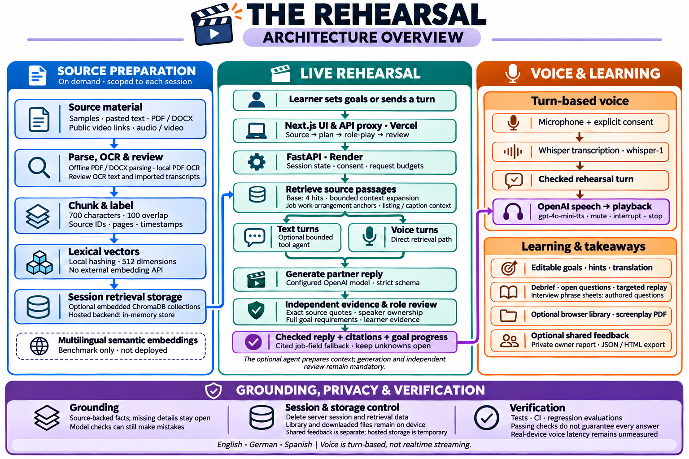
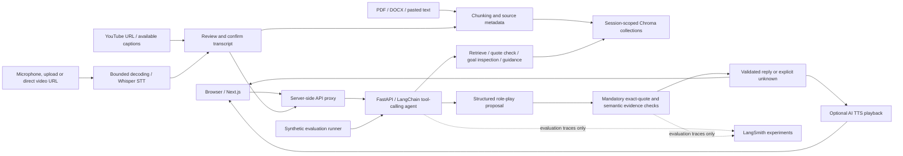

# Capstone evidence: The Rehearsal

The Rehearsal is a document-grounded conversation practice prototype, with a
Next.js frontend and a single-instance FastAPI backend. This guide maps assessment
criteria to reviewable source files and recorded evidence. Local changes must be
committed and pushed before reviewers can see them in the linked repository.

Repository: https://github.com/zinaelnahel/the-rehearsal

Current engineering status: [best-practices review](docs/BEST_PRACTICES.md).
Current deployment history: [DEPLOYMENT.md](DEPLOYMENT.md).
Historical submission evidence: [submission verification](SUBMISSION.md). Public release evidence
is published with [version 0.7.0](https://github.com/zinaelnahel/the-rehearsal/releases/tag/v0.7.0).



| Criterion | Implemented evidence | Limits of the claim |
| --- | --- | --- |
| Evaluation | [Dataset](evaluation/rag-dataset.json), [runner](scripts/evaluate_rag.py), [offline report](evaluation/rag-demo-baseline.json), [evaluation plan](EVALUATION.md) | Nine demo cases are a regression baseline, not a live-model quality score. The current real-provider nine-case run and all four judges passed; see SUBMISSION.md. |
| Automated tests | `backend/test_*.py`; see current verification in docs/MULTIMODAL.md | Stubbed live-model tests verify safeguards, not general real-model performance. |
| Historical live evidence | [Rent-flow report](evaluation/rent-fixed-slots-2026-11-02.json), [multilingual report](evaluation/multilingual-fixed-slots-2026-11-02.json) | Small historical smoke runs; not results for every subsequent code revision or proof of broad reliability. |
| Reproducibility | [README](README.md), [.env.example](.env.example), `package-lock.json`, `backend/requirements.lock` | Both stacks have lockfiles; Python transitive dependencies include hashes and are checked in CI. Dependency advisories and exceptions are documented in SECURITY.md. |
| Containerization | [Dockerfile](Dockerfile), [.dockerignore](.dockerignore), [Render configuration](render.yaml) | Container build and parser-confinement probe passed in hosted CI for the deployed source. The current source must also pass CI before release. |
| CI/CD | [CI workflow](.github/workflows/ci.yml), [release workflow](.github/workflows/release.yml), [activation steps](DEPLOYMENT.md) | Hosted CI and manual deployment checks are recorded in DEPLOYMENT.md. Independent human-reviewed live evidence is still missing; manual releases are not proof that the quality gate passed. |
| Guardrails | [Role-play and evidence review](backend/live.py), [context safeguards](backend/context.py), [API limits](backend/main.py) | Exact quotes and model review reduce risk; neither proves every response is correct or safe. |
| Production trade-offs | Cost, latency and scaling analysis below | This is a bounded single-instance prototype, not a horizontally scalable production service. |

## Architecture and model choices



This is the local implementation; speech must be enabled, and the existing free
hosting configuration uses the memory retrieval fallback. Tool preparation may be
explicitly disabled; it is enabled by default for live turns.


Live mode uses the configured pretrained model, default `gpt-4.1-mini`, through
LangChain. No model training or fine-tuning is performed. Strict JSON schemas and
Pydantic validation make generated results usable by the application. The default
is a compact model choice intended to keep inference lightweight; comparative
model quality, cost and latency have not been benchmarked.

Retrieval uses local 512-dimensional hashed word vectors, a small multilingual
alias map, chunks of 700 characters with 100-character overlap, and top-four
retrieval. Agent retrieval can expand live context to eight unique passages.
This avoids external embedding calls but has limited semantic and
cross-language understanding. It is a deliberate baseline for future comparison
with multilingual semantic embeddings.

The executable prompt sources are `backend/live.py` (`rehearse`, role-play and
evidence review), `backend/agent.py` (tool selection), `backend/main.py` (`mission`, `hint`, `finish`), and
`backend/context.py` (`CONTEXT_RULES`). Reviewers can inspect the actual instructions
instead of relying on a separate prompt description. Prompts restrict document
facts to supplied evidence, preserve the partner role and separate coaching from
role-play. Demo chat uses scripted/extractive logic and makes no model calls;
optional speech still makes external audio calls after consent.

## Multimodal implementation status

The four additions are implemented and have real-provider and hosted LangSmith
evidence in [SUBMISSION.md](SUBMISSION.md). Free hosting uses memory retrieval;
persistent Chroma is demonstrated locally. Release-specific deployment results
are recorded on the version 0.7.0 release page. See
[activation and verification](docs/MULTIMODAL.md) for configuration, API contracts,
privacy changes, test coverage and remaining evidence.

Video links additionally support public direct MP4/WebM/MOV URLs via Whisper and
full available YouTube captions, up to 100,000 characters. Direct links can select a 1–120-second clip from a longer file within the 4 MB download cap. Both require transcript
review and retain source URL/timestamps. Other hosting pages are unsupported;
blocked or missing captions use paste/upload fallbacks.

| Addition | Implementation | Remaining evidence |
| --- | --- | --- |
| Speech input/output | [Speech endpoints](backend/speech.py), [browser controls](app/Speech.js): microphone or bounded audio/video upload, Whisper STT, editable/confirmed transcripts, timestamped source citations, optional TTS of stored partner replies | Real EN/DE/ES synthetic speech round trips and browser flow passed; broad human-speech accuracy remains unmeasured |
| LangSmith | [Experiment runner](scripts/evaluate_langsmith.py), [trace boundary](backend/observability.py), manual evaluation workflow and commit-specific release gate | Two hosted experiments passed and traces were audited; application hosting remains Vercel/Render |
| Several agent tools | [Bounded LangChain agent](backend/agent.py) chooses retrieval, exact-quote checking, goal inspection and practice guidance; mandatory role-play/evidence review follows | Real model selections and hosted tool traces passed; small fictional fixtures only |
| Persistent vector database | [Chroma adapter](backend/retrieval.py): session collections, persisted expiry, explicit deletion and startup cleanup; cross-process persistence tests | Verify the actual deployment volume; existing free-host configuration explicitly uses memory |

Chroma retains the local hashed embedding baseline. Persistence is implemented;
multilingual semantic embeddings are a separate improvement, not a current claim.
Speech is opt-in (`SPEECH_ENABLED=true`) and requires provider consent in the UI.
Normal user sessions remain untraced; the explicitly invoked synthetic runner
alone enables LangSmith traces. Persistent source text/vectors change the prior
memory-only privacy claim; conversations still remain in memory.

The optional [persistent deployment Blueprint](render-persistent.yaml) needs paid
compute and a mounted disk. It has not been applied. The existing free deployment
Blueprint retains `VECTOR_STORE=memory`, so hosted durability cannot be claimed
until the persistent configuration is activated and verified.

## Reproduce the evidence

Follow [README.md](README.md) for Python/Node installation and local startup.
No provider key is needed for these checks:

```powershell
python -m pip install --require-hashes -r backend/requirements.lock
python -m unittest discover -s backend -t . -p 'test_*.py' -v
python scripts/evaluate_rag.py
npm ci
npm run build
```

The nine-case benchmark covers rent, availability and an unspecified pet policy
in English, German and Spanish, with distractor paragraphs. It checks retrieval,
goal detection, expected answer state, citation integrity, source quote support
and required answer values. The recorded demo baseline passes 9/9 cases with zero
provider calls. Those deterministic checks are not measurements of semantic
response quality or safety across arbitrary inputs.

`python scripts/evaluate_rag.py --live --judge` additionally exercises live
generation and four separate model-graded dimensions: correctness, relevance,
groundedness and retrieval relevance. It uses provider calls and writes local
results; it does not upload traces to LangSmith. Use `scripts/evaluate_langsmith.py` for the explicit synthetic LangSmith experiment. Human review is still needed,
especially because the judge uses the same configured model as the generator.
The broader synthetic dataset and human-review gate are implemented; independent
human-reviewed live quality evidence remains missing. See docs/BEST_PRACTICES.md. Safety evidence currently consists of automated regressions
for conflicting/instructional documents, fabricated quotes, unsupported replies,
negated goals, context boundaries and session isolation; no broad safety benchmark
or measured attack success rate is claimed.

## Guardrails and trust boundaries

- Documents and user-supplied context are untrusted data. The model has no shell
  or unrestricted tool execution. Agent tools are read-only and session-bound. Listing imports use a separate restricted URL
  importer rather than model-directed browsing.
- Confirmed answers require valid retrieved IDs, exact supporting text and a
  separate semantic evidence review. Unsupported generated replies are withheld
  and replaced with an explicit unknown response.
- There is no application danger-keyword scan or forced support-note pause.
  Source-grounding, schema validation and tool restrictions remain active.
- API keys remain server-side. Sessions expire after an hour of inactivity;
  deletion removes server references and its persisted retrieval collection, then verifies session inaccessibility. Logical deletion is not secure disk erasure.
- Bounded uploads, parser limits, session/turn/hint limits, provider call ceilings,
  timeouts and disabled user-session tracing reduce exposure and resource use.

Remaining risks include prompt injection, correlated generator/judge mistakes,
parser vulnerabilities, public-user abuse and provider retention. The proxy token
protects backend access through the frontend server; it is not user authentication.

## Cost, latency and scale

Without agent preparation, a live rehearsal uses one mission-generation call, two sequential calls
per learner turn, one review call on finish, and one call per live hint. For `T`
turns and `H` hints, the normal budget is **2T + H + 2 model calls**, excluding
replays and additional reviews. A five-turn scene without hints normally uses 12
calls with preparation disabled. Agent preparation adds up to two calls per turn:
the upper call budget is **4T + H + 2**, plus one call per transcription or playback.
Audio processing has separate per-request limits. The nine-case live RAG benchmark
uses 27 calls without preparation, or up to 45 with it; four judge calls per case
increase those bounds to 63 or 81. Failed calls also consume reservations.

Dollar cost has not been measured. Calculate it from actual input/output token
usage and the provider's applicable rates:

`cost = input_tokens / 1,000,000 * input_rate + output_tokens / 1,000,000 * output_rate`

Counting calls alone cannot establish cost: retrieved passages and conversation
history change input length. A future synthetic benchmark should record token
usage, per-stage elapsed times and end-to-end p50/p95 across repeated runs, with
model/version, prompt hash and retrieval configuration. Do not report a latency
percentile or dollar amount until that measurement exists.

Role-play waits for both proposal and evidence review, increasing latency in
exchange for an additional grounding check. Each provider call has a 20-second
timeout and no SDK retries; this is not an end-to-end latency guarantee. Free-host
cold starts add delay. The default hourly call ceiling is 200, with a 100-call
session ceiling and 1,400 maximum output tokens per call. These counters reset on
restart and do not replace account-level spend controls.

Conversation state and counters live in one process. Chroma source text/vectors persist on disk until deletion/expiry; memory mode remains an explicit fallback. Use one backend instance and
one Uvicorn worker; restarts erase active conversations. Persisted retrieval alone does not resume a session. Horizontal scaling requires
shared session storage, a shared retrieval store, distributed locking and global
rate/cost accounting. Production expansion also requires visitor authentication
or access controls, load tests, parser isolation, monitored error rates and a
verified release/rollback process. None of these future capabilities is implied
by hosting the current app on Vercel and Render.

## Submission checklist

1. Commit and push the source, evaluation fixtures/reports and workflows; verify
   the repository is accessible to the assessor.
2. Activate CI, inspect a successful run and configure required branch checks.
3. Configure production deployment hooks if demonstrating the manual release flow;
   verify the actual hosting builds and application health afterwards.
4. Run a synthetic live benchmark and manually review its failures before claiming
   current live quality metrics. Include model/configuration and run provenance.
5. Present the working app, repository and this guide together so evidence is
   visible outside the demo interface.
