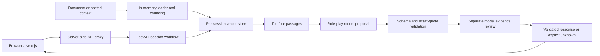

# Capstone evidence: The Rehearsal

The Rehearsal is a document-grounded conversation practice prototype, with a
Next.js frontend and a single-instance FastAPI backend. This guide maps assessment
criteria to reviewable source files and recorded evidence. Local changes must be
committed and pushed before reviewers can see them in the linked repository.

Repository: https://github.com/zinaelnahel/the-rehearsal

| Criterion | Implemented evidence | Limits of the claim |
| --- | --- | --- |
| Evaluation | [Dataset](evaluation/rag-dataset.json), [runner](scripts/evaluate_rag.py), [offline report](evaluation/rag-demo-baseline.json), [evaluation plan](EVALUATION.md) | Nine demo cases are a regression baseline, not a live-model quality score. Optional model judges have not been run for this dataset. |
| Automated tests | `backend/test_*.py`; 52 tests passed locally on 3 November 2026 | Stubbed live-model tests verify safeguards, not general real-model performance. |
| Historical live evidence | [Rent-flow report](evaluation/rent-fixed-slots-2026-11-02.json), [multilingual report](evaluation/multilingual-fixed-slots-2026-11-02.json) | Small historical smoke runs; not results for every subsequent code revision or proof of broad reliability. |
| Reproducibility | [README](README.md), [.env.example](.env.example), `package-lock.json`, `backend/requirements.txt` | Frontend dependencies have a lockfile; Python dependencies have version ranges, so backend installs are not fully pinned. |
| Containerization | [Dockerfile](Dockerfile), [.dockerignore](.dockerignore), [Render configuration](render.yaml) | Container build is configured in CI; it was not verified locally because Docker is unavailable. |
| CI/CD | [CI workflow](.github/workflows/ci.yml), [release workflow](.github/workflows/release.yml), [activation steps](DEPLOYMENT.md) | Prepared locally; GitHub execution and deployment secrets still need verification. Hook acceptance is not deployment health. |
| Guardrails | [Role-play and evidence review](backend/live.py), [context safeguards](backend/context.py), [API limits](backend/main.py) | Exact quotes and model review reduce risk; neither proves every response is correct or safe. |
| Production trade-offs | Cost, latency and scaling analysis below | This is a bounded single-instance prototype, not a horizontally scalable production service. |

## Architecture and model choices



Live mode uses the configured pretrained model, default `gpt-4.1-mini`, through
LangChain. No model training or fine-tuning is performed. Strict JSON schemas and
Pydantic validation make generated results usable by the application. The default
is a compact model choice intended to keep inference lightweight; comparative
model quality, cost and latency have not been benchmarked.

Retrieval uses local 512-dimensional hashed word vectors, a small multilingual
alias map, chunks of 700 characters with 100-character overlap, and top-four
retrieval. This avoids external embedding calls but has limited semantic and
cross-language understanding. It is a deliberate baseline for future comparison
with multilingual semantic embeddings.

The executable prompt sources are `backend/live.py` (`rehearse`, role-play and
evidence review), `backend/main.py` (`mission`, `hint`, `finish`), and
`backend/context.py` (`CONTEXT_RULES`). Reviewers can inspect the actual instructions
instead of relying on a separate prompt description. Prompts restrict document
facts to supplied evidence, preserve the partner role and separate coaching from
role-play. Demo mode uses scripted/extractive logic and makes no model calls.

## Reproduce the evidence

Follow [README.md](README.md) for Python/Node installation and local startup.
No provider key is needed for these checks:

```powershell
python -m pip install -r backend/requirements.txt
python -m unittest discover -s backend -t . -p 'test_*.py' -v
python scripts/evaluate_rag.py
npm ci
npm run build
```

The nine-case benchmark covers rent, availability and an unspecified pet policy
in English, German and Spanish, with distractor paragraphs. It checks retrieval,
goal detection, expected answer state, citation integrity, source quote support
and required answer values. The recorded demo baseline passes 9/9 cases with zero
provider calls. Those deterministic checks are not measurements of semantic
response quality or safety across arbitrary inputs.

`python scripts/evaluate_rag.py --live --judge` additionally exercises live
generation and four separate model-graded dimensions: correctness, relevance,
groundedness and retrieval relevance. It uses provider calls and writes local
results; it does not upload traces to LangSmith. Human review is still needed,
especially because the judge uses the same configured model as the generator.
The broader dataset and human annotation gates in EVALUATION.md are planned work,
not achieved scores. Safety evidence currently consists of automated regressions
for conflicting/instructional documents, fabricated quotes, unsupported replies,
negated goals, context boundaries and session isolation; no broad safety benchmark
or measured attack success rate is claimed.

## Guardrails and trust boundaries

- Documents and user-supplied context are untrusted data. The model has no shell
  or unrestricted tool execution. Listing imports use a separate restricted URL
  importer rather than model-directed browsing.
- Confirmed answers require valid retrieved IDs, exact supporting text and a
  separate semantic evidence review. Unsupported generated replies are withheld
  and replaced with an explicit unknown response.
- Sensitive-scene rules can pause role-play. Pattern matching has false positives
  and false negatives; this is not clinical safety screening.
- API keys remain server-side. Sessions expire after an hour of inactivity;
  deletion removes server references and verifies session inaccessibility.
- Bounded uploads, parser limits, session/turn/hint limits, provider call ceilings,
  timeouts and disabled tracing reduce exposure and resource use.

Remaining risks include prompt injection, correlated generator/judge mistakes,
parser vulnerabilities, public-user abuse and provider retention. The proxy token
protects backend access through the frontend server; it is not user authentication.

## Cost, latency and scale

An ordinary live rehearsal uses one mission-generation call, two sequential calls
per learner turn, one review call on finish, and one call per live hint. For `T`
turns and `H` hints, the normal budget is **2T + H + 2 model calls**, excluding
replays and additional reviews. A five-turn scene without hints normally uses 12
calls. The nine-case live RAG benchmark normally uses 27 calls; four judge calls
per case increase that to 63. Failed calls also consume application reservations.

Dollar cost has not been measured. Calculate it from actual input/output token
usage and the provider's applicable rates:

`cost = input_tokens / 1,000,000 * input_rate + output_tokens / 1,000,000 * output_rate`

Counting calls alone cannot establish cost: retrieved passages and conversation
history change input length. A future synthetic benchmark should record token
usage, per-stage elapsed times and end-to-end p50/p95 across repeated runs, with
model/version, prompt hash and retrieval configuration. Do not report a latency
percentile or dollar amount until that measurement exists.

Role-play waits for both proposal and evidence review, increasing latency in
exchange for an additional grounding check. Each provider call has a 20-second
timeout and no SDK retries; this is not an end-to-end latency guarantee. Free-host
cold starts add delay. The default hourly call ceiling is 200, with a 100-call
session ceiling and 1,400 maximum output tokens per call. These counters reset on
restart and do not replace account-level spend controls.

State, retrieval and counters live in one process. Use one backend instance and
one Uvicorn worker; restarts erase active sessions. Horizontal scaling requires
shared session storage, a shared retrieval store, distributed locking and global
rate/cost accounting. Production expansion also requires visitor authentication
or access controls, load tests, parser isolation, monitored error rates and a
verified release/rollback process. None of these future capabilities is implied
by hosting the current app on Vercel and Render.

## Submission checklist

1. Commit and push the source, evaluation fixtures/reports and workflows; verify
   the repository is accessible to the assessor.
2. Activate CI, inspect a successful run and configure required branch checks.
3. Configure production deployment hooks if demonstrating the manual release flow;
   verify the actual hosting builds and application health afterwards.
4. Run a synthetic live benchmark and manually review its failures before claiming
   current live quality metrics. Include model/configuration and run provenance.
5. Present the working app, repository and this guide together so evidence is
   visible outside the demo interface.
